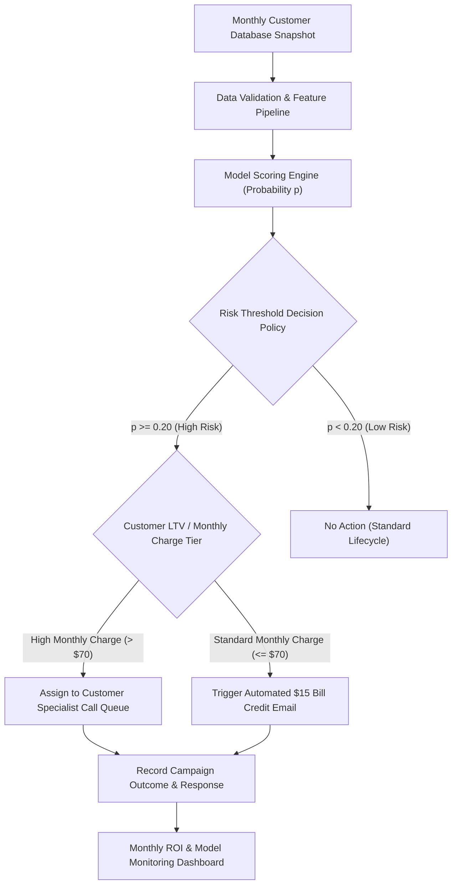

# ML Problem Framing Memo: Telecom Customer Churn & Retention Intervention

**Project Title:** ML Problem Framing & Responsible Data Card  
**Domain:** Telecommunications / Customer Success  
**Target Artifact:** Production-Oriented Retention Decision System  

---

## 1. Executive Summary & Business Decision

Telecommunications service providers face significant revenue erosion due to voluntary customer churn—where active subscribers cancel subscriptions or port out to competitors. Acquiring a replacement subscriber requires substantial marketing, sales commission, and onboarding expense ($250–$350 per user). Conversely, retaining an existing subscriber via proactive engagement (e.g., promotional discounts, plan optimizations, or targeted customer success outreach) incurs a fraction of that cost ($15–$25 per intervention).

### Core Business Decision
Every month, the Customer Success and Retention teams must decide:
1. **Which active customer accounts should receive proactive retention outreach or promotional incentives?**
2. **What tier of intervention (e.g., $15 bill credit vs. automated email vs. dedicated call queue) is financially justified given the customer's predicted risk of departure and lifetime value?**

The objective is to allocate finite retention campaign budgets to maximize net retained recurring revenue while minimizing wasteful discounts given to customers who would have stayed anyway.

---

## 2. Formal Problem Formulation

| Formulation Dimension | Specification | Business Rationale |
| :--- | :--- | :--- |
| **Prediction Target ($Y$)** | Binary indicator $Y \in \{0, 1\}$, where $Y = 1$ if the customer terminates service within the next 30 calendar days, and $Y = 0$ if the service remains active. | Aligns directly with monthly billing cycles and contract renewal schedules. |
| **Unit of Observation** | A single active customer account (`customerID`) evaluated at a specific monthly billing cycle checkpoint. | Ensures granular account-level intervention scoring. |
| **Feature Window ($T_{\text{hist}}$)** | Historical account state up to the scoring cutoff: contract type, tenure (0–72 months), service subscriptions, billing method, and monthly charges. | Captures billing history and commitment state without lookahead leakage. |
| **Prediction Horizon ($T_{\text{pred}}$)** | Next 30 calendar days following the scoring checkpoint. | Provides sufficient forward window to capture impending contract expirations or voluntary cancellations. |
| **Action Window ($T_{\text{action}}$)** | 7 to 14 calendar days prior to contract renewal or next bill generation. | Gives retention specialists sufficient operational lead time to initiate contact before cancellation. |

---

## 3. System Stakeholders & Operational Workflow

### Intended Users
* **Customer Retention Managers:** Set campaign budgets, define offer eligibility thresholds, and monitor overall campaign ROI.
* **Customer Success Specialists:** Receive daily priority call queues of high-risk, high-value accounts requiring human intervention.
* **Automated Campaign Engine:** Triggers automated loyalty emails or digital bill credits for lower-value/medium-risk cohorts.

### Decision Workflow Integration



---

## 4. Assessment: Is Machine Learning Justified?

### Comparative Framework: ML vs. Non-ML Baseline

To rigorously determine whether Machine Learning is required, we compare a supervised predictive model against a simple heuristic rule baseline.

```
+-----------------------------------------------------------------------------------+
| Baseline 0: Majority Class Predictor                                              |
| - Rule: Predict Churn = 'No' for all 7,043 customers                              |
| - Accuracy: 73.49% | Recall: 0.00% | Precision: 0.00%                              |
| - Financial Impact: Zero churn captured -> Maximum revenue loss ($186,500 test)   |
+-----------------------------------------------------------------------------------+
                                        |
                                        v
+-----------------------------------------------------------------------------------+
| Baseline 1: Domain Heuristic Rule                                                 |
| - Rule: Predict Churn = 'Yes' if Contract == 'Month-to-month' &                   |
|         InternetService == 'Fiber optic'                                          |
| - Accuracy: 76.47% | Recall: 62.20% | Precision: 54.98%                            |
| - Financial Impact: Cuts test financial loss from $186.5k to $74.3k (60.2% drop)  |
+-----------------------------------------------------------------------------------+
                                        |
                                        v
+-----------------------------------------------------------------------------------+
| Baseline 2: Standardized Logistic Regression Model                                |
| - Rule: Multi-variable weighted probability scoring p(Churn)                      |
| - At Default p >= 0.50: Acc: 80.60% | Rec: 52.55% | Prec: 67.12% | Loss: $90.4k      |
| - At Cost-Tuned p >= 0.20: Acc: 71.22% | Rec: 86.86% | Prec: 47.65% | Loss: $31.6k      |
| - Financial Impact: Reduces test financial loss to $31.6k (83.0% reduction)       |
+-----------------------------------------------------------------------------------+
```

### Comparative Analysis Table

| Evaluative Criterion | Non-ML Heuristic Baseline | Machine Learning Model (Logistic Reg / GBDT) |
| :--- | :--- | :--- |
| **Implementation Complexity** | Extremely Low (SQL `CASE WHEN` clause) | Moderate (Feature pipeline, training, scoring service) |
| **Infrastructure & Compute** | Zero specialized ML infrastructure | Requires automated batch scoring job or microservice |
| **Explainability & Audit** | 100% transparent and static rule set | Feature attribution required (SHAP / coefficients) |
| **Performance (Test Recall)** | 62.20% | **86.86%** (at tuned threshold $p \ge 0.20$) |
| **Financial Loss on Test Set**| $74,300 | **$31,620** |

### When is the Non-ML Baseline Preferable?
The non-ML heuristic baseline is **strongly preferable** under the following business conditions:
1. **Cold-Start Operations:** When launching in a new market with insufficient historical labeled churn records (< 1,000 accounts).
2. **Strict Regulatory/Audit Compliance:** Where decision logic must be statically codified and approved by compliance officers without probabilistic uncertainty.
3. **Zero ML Infrastructure Capability:** Where the organization lacks data engineering support to maintain automated feature pipelines and model drift monitors.
4. **Negligible Revenue Gain:** If the margin improvement of ML over the heuristic does not cover the software engineering and maintenance salary costs.

---

## 5. Summary of Assumptions & Unresolved Questions

### Established Facts (From Data File)
* The dataset contains 7,043 customer rows across 21 columns.
* Overall churn rate is 26.54% (1,869 churners, 5,174 non-churners).
* Tenure ranges from 0 to 72 months; `TotalCharges` has 11 blank entries strictly associated with `tenure == 0`.

### Unresolved Questions & Assumptions
* **Assumption A1:** `tenure == 0` represents newly registered accounts prior to their first monthly statement.
* **Assumption A2:** The baseline cost of false positives ($C_{FP} = \$20$) and false negatives ($C_{FN} = \$500$) reflects realistic telecom economics, but must be calibrated with finance.
* **Unknown U1:** Specific calendar timestamps or snapshot dates are unstated in the raw file.
* **Unknown U2:** Data collection methodology, customer consent disclosures, and geographic region are unstated.
