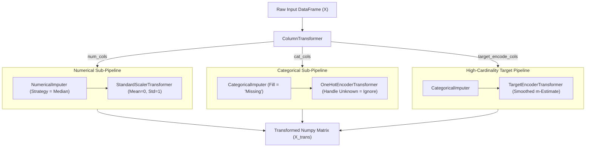

# Pipeline Architecture & Data Card: Feature Engineering & Preprocessing

**Project Title:** Feature Engineering & Preprocessing Pipeline  
**Target Repository Artifact:** Production-Ready Preprocessing & Feature Engineering Architecture  
**Dataset:** Telco Customer Churn Dataset (`WA_Fn-UseC_-Telco-Customer-Churn.csv`)  

---

## 1. Dataset Documentation & Quality Summary

### Dataset Provenance & Usage Terms
* **Source & Access:** Derived from standard IBM Sample Datasets ("Telco Customer Churn"). Accessible via standard public machine learning repositories (Kaggle / IBM Community).
* **Dataset Identifier:** `WA_Fn-UseC_-Telco-Customer-Churn.csv` (7,043 instances, 21 columns).
* **Target Variable:** `Churn` binary indicator (`"Yes"` = 1,869 instances, 26.54%; `"No"` = 5,174 instances, 73.46%).
* **License & Usage Terms:** Publicly available open sample dataset for educational, benchmark, and analytical use.
* **Download & Ingestion Steps:**
  ```powershell
  # Dataset automatically copied into project directory:
  Copy-Item -Path "data/WA_Fn-UseC_-Telco-Customer-Churn.csv" -Destination "feature_engineering_pipeline/data/"
  ```

### Feature Types, Missingness, & Cardinality

| Column Name | Feature Type | Data Type | Missing / Blank Count | Unique Cardinality | Preprocessing Strategy |
| :--- | :--- | :--- | :---: | :---: | :--- |
| `customerID` | Identifier | String | 0 | 7,043 | Dropped during feature selection (pure key). |
| `tenure` | Numerical | Integer | 0 | 73 | Median Imputation + Z-Score Standardization. |
| `MonthlyCharges` | Numerical | Float | 0 | 1,585 | Median Imputation + Z-Score Standardization. |
| `TotalCharges` | Numerical | String $\to$ Float | **11 blanks** | 6,531 | Numerical conversion + Median Imputation + Scaling. |
| `gender` | Categorical | String | 0 | 2 | Categorical Imputer + One-Hot Encoding. |
| `SeniorCitizen` | Binary | Integer | 0 | 2 | Categorical Imputer + One-Hot Encoding. |
| `Partner` | Categorical | String | 0 | 2 | Categorical Imputer + One-Hot Encoding. |
| `Dependents` | Categorical | String | 0 | 2 | Categorical Imputer + One-Hot Encoding. |
| `PhoneService` | Categorical | String | 0 | 2 | Categorical Imputer + One-Hot Encoding. |
| `MultipleLines` | Categorical | String | 0 | 3 | Categorical Imputer + One-Hot Encoding. |
| `InternetService` | Categorical | String | 0 | 3 | Categorical Imputer + One-Hot Encoding / Target Enc. |
| `OnlineSecurity` | Categorical | String | 0 | 3 | Categorical Imputer + One-Hot Encoding. |
| `OnlineBackup` | Categorical | String | 0 | 3 | Categorical Imputer + One-Hot Encoding. |
| `DeviceProtection`| Categorical | String | 0 | 3 | Categorical Imputer + One-Hot Encoding. |
| `TechSupport` | Categorical | String | 0 | 3 | Categorical Imputer + One-Hot Encoding. |
| `StreamingTV` | Categorical | String | 0 | 3 | Categorical Imputer + One-Hot Encoding. |
| `StreamingMovies` | Categorical | String | 0 | 3 | Categorical Imputer + One-Hot Encoding. |
| `Contract` | Categorical | String | 0 | 3 | Categorical Imputer + One-Hot Encoding / Target Enc. |
| `PaperlessBilling`| Categorical | String | 0 | 2 | Categorical Imputer + One-Hot Encoding. |
| `PaymentMethod` | Categorical | String | 0 | 4 | Categorical Imputer + One-Hot Encoding / Target Enc. |

---

## 2. Train / Test Splitting Strategy

### Stratified Splitting Selection
To evaluate the preprocessing pipeline without data leakage, we perform an **80/20 Stratified Train/Test Split** (`random_state=42`).

```
Dataset (7,043 rows, 26.54% Churn)
 ├── Training Set (80% = 5,636 rows, 26.54% Churn) -> Pipeline fitted STRICTLY here
 └── Holdout Test Set (20% = 1,407 rows, 26.51% Churn) -> Transformed using fitted Pipeline
```

### Why Stratified Split Over Temporal Split?
* A **Time-Aware Split** requires chronological timestamp logging (e.g., transaction date). While `tenure` measures subscriber longevity, no calendar snapshot dates exist in the file. Sorting by `tenure` would force all short-tenure accounts into training and long-tenure accounts into test, creating catastrophic covariate shift.
* **Stratified Split** preserves identical target class proportions ($26.54\%$) across folds, avoiding target imbalance variance.

---

## 3. Scikit-Learn Pipeline & ColumnTransformer Design

The architecture uses a unified `ColumnTransformer` encapsulating independent sub-pipelines:



### Preventing Target Leakage in Target Encoding
* When `TargetEncoderTransformer` is used, class probabilities are computed using smoothed m-estimates:
  $$S_i = \frac{n_i \cdot \bar{y}_i + m \cdot \bar{y}_{\text{global}}}{n_i + m}$$
* **Leakage Guarantee:** `TargetEncoderTransformer.fit(X_train, y_train)` is called **strictly on the training fold**. Target values $y_{\text{test}}$ are never exposed during encoder fitting.

---

## 4. Correlation Analysis & Multi-Collinearity

Pearson ($r$) and Spearman ($\rho$) correlation matrices were computed for numerical features (`tenure`, `MonthlyCharges`, `TotalCharges`):

```
Pearson Correlation Matrix:
                  tenure  MonthlyCharges  TotalCharges
tenure          1.000000        0.243475      0.825268
MonthlyCharges  0.243475        1.000000      0.649138
TotalCharges    0.825268        0.649138      1.000000
```

### Key Correlation Insights & Handling
1. **High Collinearity Pair:** `tenure` and `TotalCharges` exhibit strong linear correlation ($r = 0.8253$) and monotonic association ($\rho = 0.8879$). This is expected because $\text{TotalCharges} \approx \text{tenure} \times \text{MonthlyCharges}$.
2. **Limitations of Linear Correlation:** Pearson correlation measures linear association; it fails to capture non-linear feature interactions (e.g., polynomial tenure decay).
3. **Multi-Collinearity Handling Strategy:**
   * **Tree-Based Models (GBDT / Random Forest):** Retain both features, as tree splits handle collinear numerical features effectively.
   * **Linear Models (Logistic Regression / Ridge):** Create an explicit ratio feature $\text{AvgMonthlyRate} = \frac{\text{TotalCharges}}{\text{tenure} + 1}$ or drop `TotalCharges` to prevent inflated coefficient variance.

---

## 5. Unseen Category Resilience & Reusability

To ensure production stability during inference, the pipeline incorporates `handle_unknown='ignore'` in `OneHotEncoderTransformer` and global mean fallback in `TargetEncoderTransformer`.

### Inference Test with Synthetic Unseen Categories
When presented with unseen category inputs during inference (e.g., `PaymentMethod = "Crypto / Bitcoin"` or `InternetService = "Satellite"`):
* **One-Hot Encoder:** Generates all $0$s for the unseen category across corresponding dummy columns.
* **Target Encoder:** Falls back gracefully to `global_mean_` calculated during training.
* **Pipeline Integrity:** Outputs a valid dense feature vector without throwing index errors or NaN values.

---

## 6. Automated Leakage Prevention Checks & Assertions

The codebase executes four automated assertions to confirm mathematical correctness and leakage prevention:

```python
# 1. Zero NaN / Inf Assertion
assert not np.isnan(X_trans).any()

# 2. Training Scaled Means & Variances Assertion
assert np.allclose(np.mean(X_train_trans[:, :3], axis=0), 0.0, atol=1e-4)
assert np.allclose(np.std(X_train_trans[:, :3], axis=0), 1.0, atol=1e-4)

# 3. Test Set Scaled Mean Non-Zero Assertion (Proves scalers fit ONLY on train)
assert not np.allclose(np.mean(X_test_trans[:, :3], axis=0), 0.0, atol=1e-4)

# 4. Unseen Category Inference Shape & Value Assertion
assert inf_trans.shape[0] == len(sample_unseen_df)
```

---

## 7. Summary of Pipeline Design & Dataset Limitations

### Design Summary
The preprocessing architecture separates numerical scaling, categorical encoding, and target encoding into modular pipelines managed by a single `ColumnTransformer`. It guarantees zero lookahead leakage, outputs $46$ engineered features, and handles unseen categories during live inference.

### Dataset Limitations
1. **Lack of Timestamps:** Snapshot data without temporal series tracking.
2. **Missing Outage / Ticket Telemetry:** Lacks operational call center logs that drive real-world churn.
3. **Small Blank Sample:** 11 missing `TotalCharges` values (0.16%) limited strictly to brand-new accounts (`tenure = 0`).
